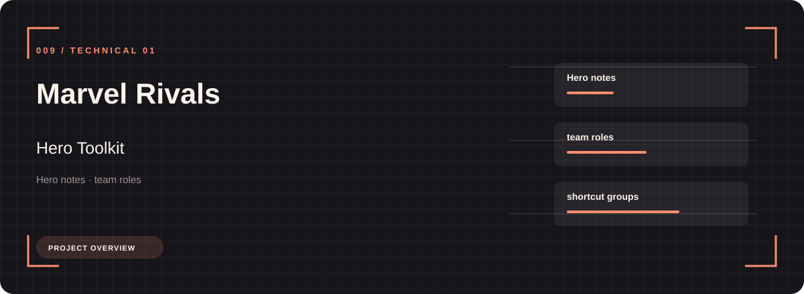
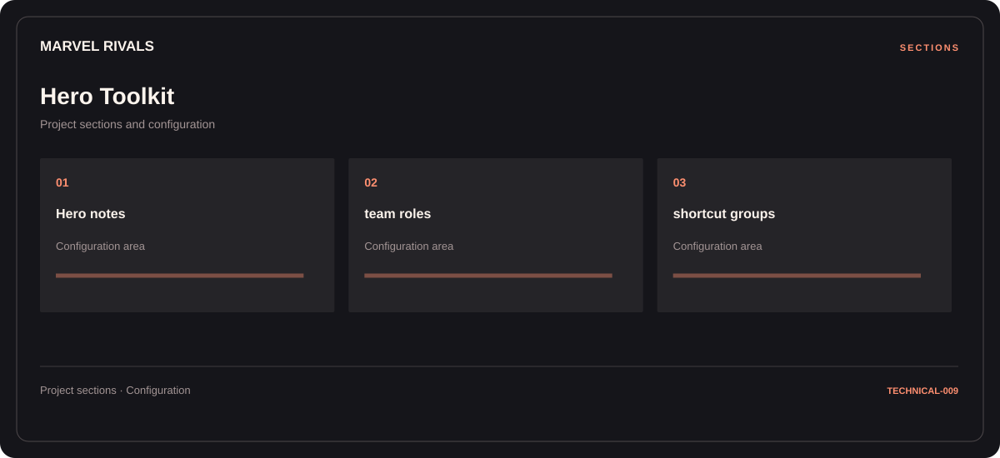

# 🎮 Marvel Rivals Hero Toolkit

**Hero notes · Team roles · Shortcut groups**

## ⚡ Features

Hero notes, team roles, and shortcut groups form the core of Marvel Rivals Hero Toolkit. Related configuration is grouped by task rather than collected in an undifferentiated list.

### ⚙️ Hero notes

Character or team groups presented with the context needed to organize a session.

### 🧩 Team roles

Character or team groups presented with the context needed to organize a session.

### ⌨️ Shortcut groups

Shortcut assignments and control mappings, organized in one reference section.

## 🖥️ Project navigation

## 📥 Download

The button and cover open the project's download page. Use the information supplied with the downloaded package for installation and release-specific requirements.

## 📚 Project documentation

- [Feature reference](docs/FEATURES.md)
- [Download information](docs/DOWNLOAD.md)
- [Project page](index.html)

---

Marvel Rivals Hero Toolkit · Program documentation and download information.
